# Diagrama de Clases UML - HotelUQ
## Sistema Integral de Gestión Hotelera
**Universidad del Quindío - Programación II**

A continuación se presenta el diagrama de clases completo del dominio, principios SOLID y patrones de diseño implementados en la plataforma **HotelUQ**.

```mermaid
classDiagram
    direction TB

    %% Jerarquía de Usuarios
    class Persona {
        <<abstract>>
        #String identificacion
        #String nombre
        #String email
        #String telefono
        #String password
        +getIdentificacion() String
        +getNombre() String
    }

    class Cliente {
        -TarjetaVirtual tarjetaVirtual
        -CuentaPuntos cuentaPuntos
        +getTarjetaVirtual() TarjetaVirtual
        +getCuentaPuntos() CuentaPuntos
    }

    class Administrador {
        -String cargo
        +getCargo() String
    }

    Persona <|-- Cliente
    Persona <|-- Administrador

    %% Tarjeta Virtual y Movimientos
    class TarjetaVirtual {
        -String numeroTarjeta
        -double saldo
        -boolean activa
        -List~MovimientoTarjeta~ movimientos
        +recargar(double monto, String detalle) void
        +debitar(double monto, String concepto) void
        +reembolsar(double monto, String motivo) void
    }

    class MovimientoTarjeta {
        -String id
        -LocalDateTime fechaHora
        -TipoMovimiento tipo
        -double monto
        -String descripcion
        -double saldoPosterior
    }

    Cliente *-- TarjetaVirtual
    TarjetaVirtual "1" *-- "0..*" MovimientoTarjeta

    %% Programa de Puntos HotelUQ
    class CuentaPuntos {
        -String clienteIdentificacion
        -List~RegistroPuntos~ registros
        +acumularPorPago(double monto, LocalDate fecha, String det) int
        +redimirPuntos(int puntos, LocalDate fecha) void
        +getPuntosValidos(LocalDate fecha) int
    }

    class RegistroPuntos {
        -String id
        -int puntosOriginales
        -int puntosDisponibles
        -LocalDate fechaObtencion
        -LocalDate fechaVencimiento
        +estaVencido(LocalDate ref) boolean
        +consumirPuntos(int cant) int
    }

    Cliente *-- CuentaPuntos
    CuentaPuntos "1" *-- "0..*" RegistroPuntos

    %% Jerarquía de Habitaciones (Factory Method)
    class Habitacion {
        <<abstract>>
        #String numero
        #int piso
        #TipoHabitacion tipo
        #double precioBaseNoche
        #String descripcion
        #boolean activa
        +calcularTarifaBase(int noches)* double
        +getCapacidadMaxima() int
    }

    class HabitacionEstandar {
        +calcularTarifaBase(int noches) double
    }
    class HabitacionFamiliar {
        +calcularTarifaBase(int noches) double
    }
    class HabitacionSuite {
        +calcularTarifaBase(int noches) double
    }
    class HabitacionPresidencial {
        +calcularTarifaBase(int noches) double
    }

    Habitacion <|-- HabitacionEstandar
    Habitacion <|-- HabitacionFamiliar
    Habitacion <|-- HabitacionSuite
    Habitacion <|-- HabitacionPresidencial

    class HabitacionFactory {
        <<creational>>
        +crearHabitacion(TipoHabitacion tipo, String num, int piso, double precio, String desc)$ Habitacion
    }

    HabitacionFactory ..> Habitacion : crea

    %% Patrón Estructural Composite: Servicios
    class ComponenteServicio {
        <<interface>>
        +getId() String
        +getNombre() String
        +getPrecio() double
        +isPaquete() boolean
    }

    class ServicioSimple {
        -String id
        -String nombre
        -double precio
        +getPrecio() double
    }

    class PaqueteServiciosComposite {
        -double porcentajeDescuento
        -List~ComponenteServicio~ componentes
        +agregarComponente(ComponenteServicio comp) void
        +getPrecio() double
    }

    ComponenteServicio <|.. ServicioSimple
    ComponenteServicio <|.. PaqueteServiciosComposite
    PaqueteServiciosComposite "1" o-- "0..*" ComponenteServicio : contiene

    %% Patrón Creacional Builder y Entidad Reserva
    class IDetalleReserva {
        <<interface>>
        +getCodigo() String
        +getPrecioFinal() double
        +tieneSeguroCancelacionFlexible() boolean
    }

    class Reserva {
        -String codigo
        -Cliente cliente
        -Habitacion habitacion
        -LocalDate fechaEntrada
        -LocalDate fechaSalida
        -int numeroHuespedes
        -List~ComponenteServicio~ servicios
        -Promocion promocionAplicada
        -double totalNeto
        -EstadoReserva estadoActual
        +recalcularTotales() void
        +seSuperponeCon(LocalDate in, LocalDate out) boolean
    }

    IDetalleReserva <|.. Reserva
    Reserva --> Cliente
    Reserva --> Habitacion
    Reserva "1" o-- "0..*" ComponenteServicio

    class ReservaBuilder {
        <<creational>>
        +paraCliente(Cliente c) ReservaBuilder
        +enHabitacion(Habitacion h) ReservaBuilder
        +conFechas(LocalDate in, LocalDate out) ReservaBuilder
        +conHuespedes(int n) ReservaBuilder
        +conServicios(List~ComponenteServicio~ s) ReservaBuilder
        +build() Reserva
    }
    ReservaBuilder ..> Reserva : construye

    %% Patrón Estructural Decorator
    class DecoradorReserva {
        <<abstract>>
        #IDetalleReserva reservaEnvuelto
        +getPrecioFinal() double
    }
    class SeguroCancelacionFlexibleDecorator {
        +getPrecioFinal() double
        +tieneSeguroCancelacionFlexible() boolean
    }
    class ServicioVIPDecorator {
        +getPrecioFinal() double
    }

    IDetalleReserva <|.. DecoradorReserva
    DecoradorReserva <|-- SeguroCancelacionFlexibleDecorator
    DecoradorReserva <|-- ServicioVIPDecorator
    DecoradorReserva o-- IDetalleReserva

    %% Patrón de Comportamiento State
    class EstadoReserva {
        <<interface>>
        +confirmar(Reserva r) void
        +cancelar(Reserva r, boolean hotel) void
        +completar(Reserva r) void
    }
    class EstadoPendiente {
        +confirmar(Reserva r) void
    }
    class EstadoConfirmada {
        +cancelar(Reserva r, boolean hotel) void
        +completar(Reserva r) void
    }
    class EstadoCancelada
    class EstadoCompletada

    EstadoReserva <|.. EstadoPendiente
    EstadoReserva <|.. EstadoConfirmada
    EstadoReserva <|.. EstadoCancelada
    EstadoReserva <|.. EstadoCompletada
    Reserva *-- EstadoReserva

    %% Patrón de Comportamiento Strategy
    class PoliticaCancelacionStrategy {
        <<interface>>
        +calcularPorcentajeReembolso(LocalDateTime in, LocalDateTime cancel) double
    }
    class PoliticaCancelacionClienteStrategy {
        +calcularPorcentajeReembolso(LocalDateTime in, LocalDateTime cancel) double
    }
    class PoliticaCancelacionHotelStrategy {
        +calcularPorcentajeReembolso(LocalDateTime in, LocalDateTime cancel) double
    }

    PoliticaCancelacionStrategy <|.. PoliticaCancelacionClienteStrategy
    PoliticaCancelacionStrategy <|.. PoliticaCancelacionHotelStrategy

    %% Patrón Estructural Adapter y Template Method para Reportes
    class IExportadorReporte {
        <<interface>>
        +exportar(DatosReporte datos, File dest) void
    }
    class ReporteTxtAdapter
    class ReportePdfAdapter
    IExportadorReporte <|.. ReporteTxtAdapter
    IExportadorReporte <|.. ReportePdfAdapter

    class PlantillaReporte {
        <<abstract>>
        +generar(List~Reserva~ res, LocalDate in, LocalDate out) DatosReporte
        #procesarFilas(DatosReporte d, List~Reserva~ r)* void
        #calcularTotales(DatosReporte d, List~Reserva~ r)* void
    }
    class ReporteIngresosTemplate
    class ReporteOcupacionTemplate
    PlantillaReporte <|-- ReporteIngresosTemplate
    PlantillaReporte <|-- ReporteOcupacionTemplate

    %% Patrón Estructural Facade
    class HotelFachada {
        <<structural>>
        -HotelUQService service
        +getInstance()$ HotelFachada
        +autenticar(String email, String pass) Persona
        +consultarHabitacionesDisponibles(LocalDate in, LocalDate out) List~Habitacion~
        +confirmarReserva(ReservaBuilder b) Reserva
        +cancelarReservaPorCliente(String cod) double
        +cancelarReservaPorHotel(String cod, String motivo) double
        +recargarTarjetaVirtual(String id, double monto, String det) void
        +exportarReporte(PlantillaReporte p, IExportadorReporte e, File f) void
    }
```

